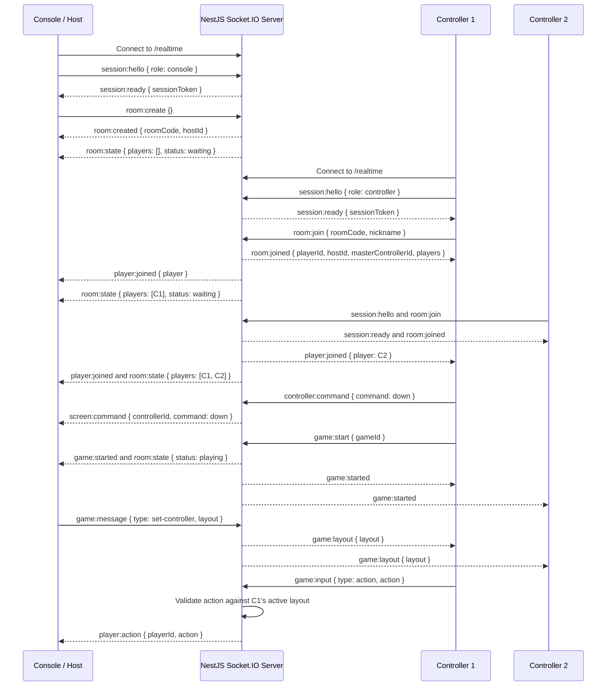

# Realtime Connection Lifecycle

This document describes the current server-side connection flow for a console host and mobile controllers. It follows the Socket.IO events implemented by `RealtimeGateway`.

## Connection details

- Socket.IO namespace: `/realtime`
- Local server URL: `http://localhost:3000/realtime`
- HTTP and Socket.IO share port `3000` by default. Use `PORT` for npm launches or `SERVER_PORT` for the Docker host port. The development Node inspector uses a separate port, `9229`; see [environment and ports](../README.md#environment-and-ports).
- Protocol envelope: `{ v: 0.2, timestamp: number, payload: ... }`
- Every timestamp is a Unix time in milliseconds (`Date.now()`).
- All client events must use the envelope and must be sent after role assignment, except `session:hello` and `session:reconnect`.
- A connection that has not completed `session:hello` within five seconds is disconnected.

`session:hello` is a role handshake, not user or device authentication: the client declares `console` or `controller`, and the server assigns that role to the socket. There are no accounts, passwords, or external identity checks in this server. Authorization is then enforced using the assigned role and room state. `hostId` and `hostSocketId` identify the screen host. `masterControllerId` independently identifies the elected phone; it never replaces the screen host identity. Game messages are sent by the screen-host connection that owns the room; there is no separate game socket role.

Example helper:

```ts
const envelope = <T>(payload: T) => ({
  v: 0.2 as const,
  timestamp: Date.now(),
  payload,
})
```

## Full lifecycle



## 1. Host connects and creates a room

Create a Socket.IO client for the namespace, then authenticate it as the console. The server returns a session token in `session:ready`.

```ts
const host = io('http://localhost:3000/realtime')

host.on('connect', () => {
  host.emit('session:hello', envelope({ role: 'console' }))
})

host.on('session:ready', ({ payload }) => {
  sessionStorage.setItem('realtimeSessionToken', payload.sessionToken)
  host.emit('room:create', envelope({}))
})

host.on('room:created', ({ payload }) => {
  console.log('Room code:', payload.roomCode)
})
```

The server creates a six-character code from an alphabet that avoids `0`, `1`, `I`, and `O`, assigns the host id, and sends:

- `room:created` directly to the host, with `roomCode` and `hostId`.
- `room:state` to the Socket.IO room, with the current players and `status: "waiting"`.

The room and its session state are currently stored in server memory.

Creating another room from the same console first leaves its current room. If it was host, the current room migrates to its first remaining controller, or closes if it has no controllers. Room codes are generated as six characters; incoming codes are trimmed, case-normalized, and validated as 4–6 alphanumeric characters.

## 2. Controllers join

Each phone connects independently, authenticates as a controller, then joins using the room code. The current limit is eight controllers per room.

```ts
const controller = io('http://localhost:3000/realtime')

controller.on('connect', () => {
  controller.emit('session:hello', envelope({ role: 'controller' }))
})

controller.on('session:ready', () => {
  controller.emit('room:join', envelope({
    roomCode: 'U2ZGH4',
    nickname: 'Alex',
    avatar: 'avatar-1', // optional
  }))
})

controller.on('room:joined', ({ payload }) => {
  sessionStorage.setItem('playerId', payload.playerId)
})
```

The first controller to join becomes the room's `masterControllerId`; later controllers join as regular players. For each successful join:

- The joining controller receives `room:joined`, including its `playerId`, screen `hostId`, `masterControllerId`, and player list.
- Existing room members receive `player:joined` and an updated `room:state`.
- The server normalizes the nickname and removes control characters and angle brackets.

Join payload constraints are: nickname 1–32 characters after trimming, optional avatar up to 64 characters, and no more than eight players in a room. Nicknames are Unicode-normalized, control characters and `<`/`>` are removed, whitespace is collapsed, and the result is trimmed and limited to 32 characters. Avatars are only trimmed and length-checked; the server does not verify that an avatar id exists.

With two controllers, both receive the same room state and each has a different `playerId`.

If a join fails because the room does not exist or is full, the server returns an error and leaves the controller's existing room unchanged. A successful join first removes the controller from its previous room. The server does not reserve nicknames or prevent duplicate display names.

## 3. Master controller manages screen menus

Only the current master controller may send menu commands. The server validates the command and forwards it only to the current screen host as `screen:command`:

```ts
controller.emit('controller:command', envelope({ command: 'down' }))
// The screen host receives { controllerId, command: 'down' }.
```

Allowed commands are `up`, `down`, `left`, `right`, `confirm`, and `back`. These commands cannot carry arbitrary screen or game messages.

## 4. Master controller starts a game and screen host defines controls

The screen host or current master controller may start a game by id:

```ts
host.emit('game:start', envelope({ gameId: 'demo-game' }))
```

The server sets the room status to `playing` and broadcasts `game:started` and an updated `room:state`.

The master controller can pause, resume, or stop the active game without sending a general-purpose `game:message`:

```ts
controller.emit('controller:game-control', envelope({ action: 'pause' }))
controller.emit('controller:game-control', envelope({ action: 'resume' }))
controller.emit('controller:game-control', envelope({ action: 'stop' }))
```

Pause is accepted only while the room is `playing`; resume only while it is `paused`; stop only while a game is `playing` or `paused`. Stop sets the room status to `finished` and broadcasts `game:ended` and `room:state`. It ends the current game but leaves the room open. Invalid state transitions return `CONFLICT`.

The screen host then sends a controller layout using the SDK screen message shape:

```ts
host.emit('game:message', envelope({
  type: 'set-controller',
  layout: {
    components: [
      { kind: 'button', id: 'jump', label: 'Jump' },
      { kind: 'dpad', id: 'move', label: 'Move' },
    ],
  },
}))
```

Every controller receives `game:layout`. To assign a layout to only one controller, include that player's id as `playerId` in the `set-controller` message. The server stores that layout for action validation.

## 5. Controllers send actions

An action uses the SDK controller message shape:

```ts
controller.emit('game:input', envelope({
  type: 'action',
  action: {
    componentId: 'jump',
    value: { kind: 'button', pressed: true },
  },
}))
```

The server checks that:

1. The sender authenticated as a controller and joined a room.
2. The room is currently playing.
3. The component exists in that player's layout and its value kind matches the component.
4. A choice value, if used, selects an option present in the layout.

Accepted input is sent to the host as `player:action` with `playerId` and `action`. Invalid input produces a versioned `error` event.

## 6. Private data, scores and game lifecycle

The host can send data to one player:

```ts
host.emit('game:message', envelope({
  type: 'private',
  playerId: 'PLAYER_ID',
  data: { secret: 'only this player receives it' },
}))
```

Only that player's socket receives `game:private`. The host can report scores with a `score` screen message; the server broadcasts valid scores as `game:score`.

Turns and achievements are private too:

| Screen message | Server effect |
|---|---|
| `turn` with `playerId`, or `null` for nobody | Stores the turn in the room and sends each controller `game:turn` with only `isYourTurn`. A controller that joins or reconnects gets it too. A turn given to an unknown player is ignored and logged. |
| `achievement` with `playerId` and `achievementId` | Sends `game:achievement` to that player's socket only. |

Lifecycle screen messages have these server effects:

| Screen message | Server effect |
|---|---|
| `lifecycle: pause` | Sets room status to `paused`; broadcasts `game:paused` and `room:state`. |
| `lifecycle: resume` | Sets room status to `playing`; broadcasts `game:started` and `room:state`. |
| `lifecycle: end` | Sets room status to `finished`; broadcasts `game:ended` and `room:state`. |

The screen host and current master controller may send `game:start`. The master controller may use `controller:game-control` for pause, resume, and stop. Only the current screen-host socket may send `game:message`; the master controller cannot send arbitrary game messages. A layout targeted at a player that is not in the room is stored for that player id but has no current recipient. A private message for a player who is not currently in the room is ignored. Scores are broadcast only when their player id belongs to a current room member.

## 7. Leaving, kicking and host migration

A member can leave with an empty `room:leave` envelope:

```ts
controller.emit('room:leave', envelope({}))
```

The server removes that controller and its individual layout, then broadcasts `player:left` and an updated `room:state`. The screen host or current master controller can remove a current player with `room:kick`:

```ts
manager.emit('room:kick', envelope({ playerId: 'PLAYER_ID' }))
```

The removed controller is taken out of the room and, if still connected, receives `error` with code `UNAUTHORIZED` and message `You were removed from the room`. Other room members receive `player:left` and the updated room state. Kicking removes the current membership; it does not ban the controller from joining again. If a controller currently owns the screen-host socket after host migration, managers cannot kick it; it must leave or disconnect so the normal host-migration path can run.

When the master controller leaves voluntarily or its reconnect grace period expires, the earliest remaining controller becomes master and `room:state` publishes the updated `masterControllerId`. This is independent of screen-host migration. When a screen host leaves, the first remaining controller becomes screen host and everyone still in the room receives `host:changed` and a new `room:state`; this does not by itself change `masterControllerId`. A controller may therefore hold both roles after screen-host migration. If no controllers remain after the screen host leaves, the room is deleted.

## 8. Ping and connection errors

Use the `ping` event to measure round-trip time:

```ts
host.emit('ping', envelope({ id: Date.now() }))
host.on('pong', ({ payload }) => console.log(payload.id, payload.serverTimestamp))
```

Listen to Socket.IO's `connect`, `disconnect`, and `connect_error` events for transport connection state. Server-side application errors arrive on `error` as an envelope whose payload contains a code and message. The protocol uses these application error codes:

| Code | Meaning |
|---|---|
| `PROTOCOL_ERROR` | Invalid `session:hello` message or unsupported protocol version in a client event. |
| `INVALID_PAYLOAD` | Malformed event payload, unknown event, or controller action that does not match its layout. |
| `ROOM_NOT_FOUND` | Requested room or player does not exist. |
| `ROOM_FULL` | The room already has eight controllers. |
| `UNAUTHORIZED` | Role or host permissions failed, event arrived before role assignment, or a resume token is unknown/expired. |
| `CONFLICT` | Duplicate role handshake, resume attempted while the prior socket remains connected, or controller input without an active game. |
| `RATE_LIMITED` | Reserved in the protocol; rate limiting is not implemented yet. |

Malformed events produce a versioned error and are not applied. Unknown event names also produce `INVALID_PAYLOAD`. Rejected inputs may include up to 16 safe schema issue descriptions in `details`.

## 9. Disconnect and resume a session

The `sessionToken` from `session:ready` can resume a disconnected host or controller for 30 seconds. After reconnecting a new Socket.IO connection, send `session:reconnect` instead of `session:hello`:

```ts
controller.on('connect', () => {
  controller.emit('session:reconnect', envelope({
    sessionToken: sessionStorage.getItem('realtimeSessionToken'),
  }))
})

controller.on('session:ready', ({ payload }) => {
  // playerId is included when the previous room membership was restored.
  console.log('Resumed player:', payload.playerId)
})
```

During the grace period, the server preserves the room slot and player id, including master-controller status. A controller's reconnection restores its membership and layout; a screen host's reconnection restores screen-host authority. A token cannot resume while its previous socket is still connected. A well-formed but unknown or expired token returns `UNAUTHORIZED`; a malformed token envelope returns `INVALID_PAYLOAD`. A still-connected prior socket returns `CONFLICT`. On expiry, the server removes that session and applies the normal leave, master-controller promotion, and screen-host migration behavior. Tokens and rooms are process-local, so a server restart invalidates them immediately.

## Current limitations and implementation details

- Rooms and sessions are in memory; a server restart clears them.
- Reconnection grace is fixed at 30 seconds.
- The five-second authentication deadline and 30-second reconnect grace are fixed constants, not environment settings.
- There is no rate limiting yet.
- Nickname filtering is basic and does not apply a profanity policy to arbitrary game text.
- The console host connection sends game messages; game runtimes do not connect directly with a separate role.
- Session tokens are bearer credentials: anyone holding a valid token can resume that disconnected session during its grace period. Keep them private and avoid logging them.
- Room and session state is not shared between server instances; run one instance unless shared storage/coordination is added.
